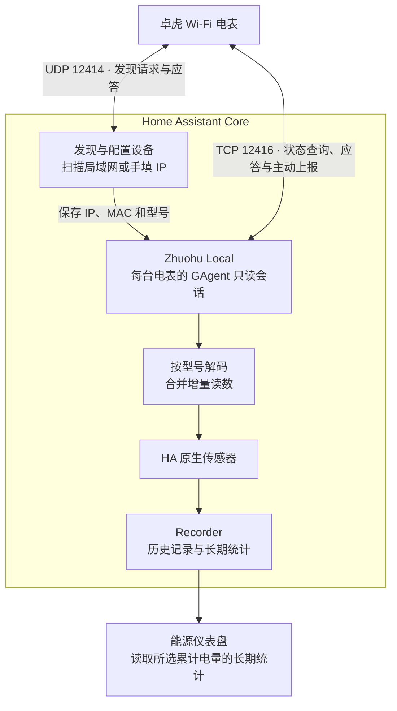

# 卓虎电表本地集成

在 Home Assistant 中直接读取卓虎 Wi-Fi 电表。集成通过局域网接收电表上报，为每台表创建独立设备和传感器。

| 支持型号 | 读数 |
| --- | --- |
| WiFi 单相电测模块 001 | 电压、电流、频率、功率因数、有功功率、无功功率、累计电量 |
| WiFi 三相电测模块 | 各相电压和电流，各相及合相的功率因数、有功功率、无功功率和累计电量 |

## 采集架构

## 实现原理

- **识别设备与保存配置**。配置流程通过 `UDP 12414` 读取发现应答中的 MAC 和产品标识，匹配内置的型号定义。确认能通过 TCP 读出有效数据后，HA 为每台表保存一条独立的集成配置，记录 IP、MAC 和型号。MAC 用于判断设备是否已添加。 [设备发现](custom_components/zhuohu_local/discovery.py) · [配置流程](custom_components/zhuohu_local/config_flow.py)
- **管理采集任务和实体**。加载配置时，HA Core 为每台表启动一个异步采集任务，并按型号注册原生传感器。传感器订阅读数变化和可用性变化，由采集任务通知 HA 更新。卸载设备时，HA 停止对应任务。 [集成入口](custom_components/zhuohu_local/__init__.py) · [传感器实现](custom_components/zhuohu_local/sensor.py)

## 采集原理

1. **建立只读会话**。HA 主动连接电表的 `TCP 12416`，完成 GAgent 局域网登录。连接成功后立即查询一次状态，之后每 3 秒发送心跳、每 30 秒查询状态。查询应答和电表主动上报共用这条连接。 [GAgent 会话实现](custom_components/zhuohu_local/protocol.py)
2. **解码并换算**。报文中的数据点位图标记本帧包含的字段。集成按该型号定义的字段顺序和字节长度取值，检查数值范围，再使用 `原始值 × 倍率 + 偏移量` 换算。例如电压字段的原始值 `23015` 对应 `230.15 V`。 [型号字段定义](custom_components/zhuohu_local/profile_data.py) · [数据点解码](custom_components/zhuohu_local/profiles.py)
3. **合并读数并处理掉线**。增量报文只更新本帧包含的有效字段，其他字段继续使用最近一次有效读数。读帧超时或断线后，集成会标记该设备不可用并重连。连接仍在收帧但连续两分钟没有有效读数时，也会将该设备标记为不可用。 [采集任务](custom_components/zhuohu_local/runtime.py)
4. **累计电量进入能源统计**。电量传感器直接使用电表上报的累计用电数据点，单位为 `kWh`，状态类别为 `total_increasing`。Recorder 保存长期统计，能源仪表盘根据所选电量传感器的累计变化汇总用电量。 [Home Assistant 长期统计文档](https://www.home-assistant.io/docs/configuration/long-term-statistics/)

## 安装

1. 从 GitHub 下载本仓库，把 `custom_components/zhuohu_local` 整个目录复制到 Home Assistant 的 `/config/custom_components/`。
2. 确认文件路径为 `/config/custom_components/zhuohu_local/manifest.json`，然后重启 Home Assistant Core。
3. 在「设置 → 设备与服务 → 添加集成」里搜索 **Zhuohu Local**。

## 添加电表

### 扫描局域网

选择「扫描局域网」，从结果中选一台电表。列表显示型号、IP 和 MAC 地址。其余电表可重复添加。

集成在 HA 已启用的私有 IPv4 网段发送 GAgent 发现报文。包含 512 个地址以内的网段还会逐地址查询。较大的网段使用广播发现。HA 与电表位于同一广播域时，扫描更容易成功。

### 手动填写 IP

选择「手动填写 IP」，输入电表的局域网 IPv4 地址。通常会自动识别型号和 MAC。UDP 发现无法识别时，页面会让你补充电表的 MAC 地址和型号，再验证 TCP 连接和实际读数。

建议在路由器上按 MAC 为各电表保留 IP。集成按 MAC 区分设备。

## 查看读数

在「设置 → 设备与服务 → Zhuohu Local」中选择电表，即可查看传感器。累计电量以 `kWh` 记录，可在 HA 的能源仪表盘中选择。三相电表提供各相和合相累计电量，统计总用电时选合相。

## 常见问题

- **扫描不到电表**。确认电表已连接 Wi-Fi，HA 与电表所在网络允许 `UDP 12414` 发现。跨网段时可以手动输入 IP。
- **无法添加或读数显示不可用**。确认 HA 能连接电表的 `TCP 12416`，并检查路由器上的 IP 及 Wi-Fi 状态。集成会在连接中断后重连，连续两分钟没有有效读数时会标为不可用。
- **能源仪表盘暂时没有图表**。先确认累计电量传感器已有数字读数。长期电量统计按小时汇总。 [Home Assistant 长期统计文档](https://www.home-assistant.io/docs/configuration/long-term-statistics/)
