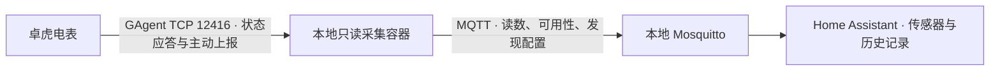

# 卓虎电表局域网采集与 Home Assistant 接入

这套方案适用于能通过机智云 GAgent 在局域网读取的卓虎 Wi-Fi 电表。Home Assistant 自定义集成直接连接电表，为每台设备创建本地传感器。

## 安装 Home Assistant 自定义集成

1. 将本仓库的 `custom_components/zhuohu_local` 整个目录复制到 Home Assistant 的 `/config/custom_components/`，重启 Home Assistant Core。
2. 在「设置 → 设备与服务 → 添加集成」里搜索 **Zhuohu Local**。
3. 选择「扫描局域网」后，从结果里选择一台表。也可以选「手动填写 IP」。如果电表的 UDP 发现应答无法到达 HA，手动输入可以补充型号和 MAC，再通过 TCP 验证实际读数。
4. 对其余电表重复添加。推荐在路由器上按 MAC 保留 IP。

集成对 HA 启用的私有 IPv4 网段发送 GAgent 发现报文。/23 或较小的网段会同时逐地址查询。较大的网段使用广播发现。每台电表单独维护连接，掉线后自动重连。当前支持 **WiFi 单相电测模块 001** 和 **WiFi 三相电测模块**。

已有确定地址的安装可以通过以下配置导入设备。导入后，设备出现在「设备与服务」，按 MAC 去重。

```yaml
zhuohu_local:
  hosts:
    - 192.168.1.100
    - 192.168.1.101
```

若从 MQTT 或 Node-RED 迁移，先在 HA 核对新集成的读数和可用性。能源仪表盘按统计 ID 使用历史数据。需要接续原曲线时，交接前先核对同一电表的累计电量，再让原统计 ID 继续接收本地读数。 [Home Assistant 长期统计文档](https://www.home-assistant.io/docs/configuration/long-term-statistics/)

## 原 Docker 和 MQTT 采集方案

下面记录原先在两台单相电表和一台三相电表上验证的 Docker 采集方案。Docker 主机主动连接电表，接收实时数据，再通过本地 Mosquitto 将传感器发布给 Home Assistant。



## 接入条件

- 电表已完成 Wi-Fi 配网。路由器通过 DHCP 保留地址，使采集主机能持续使用同一 IP。
- 从 Docker 主机能连到电表的 `TCP 12416`。机智云的局域网发现使用 `UDP 12414`，适合在同一广播域内确认设备。
- Home Assistant 已接入本地 Mosquitto，MQTT Discovery 使用默认前缀 `homeassistant`。
- 采集容器与 Mosquitto 在同一个 Docker 网络内。项目中的 `MQTT_HOST` 指向该网络内可解析的 broker 服务名。

## 采集与解码

采集器按 GAgent 的正常局域网流程登录，每三秒发送心跳，每三十秒查询一次状态，同时接收电表主动上报。可变长报文通过位图标记本帧携带的字段，采集器按产品数据点定义解码，将有效字段合并到最近一次读数。

首次适配型号时，通过机智云的产品数据点接口核对字段顺序、字节长度和倍率。数据点的实际值按 `原始值 × ratio + addition` 计算。单相表与三相表有各自的定义，累计电量和功率因数的倍率也可能不同。运行时解码使用随采集项目保存的数据点定义。 [机智云 Open API](https://docs.gizwits.com/zh-cn/Cloud/openapi_apps.html)

| 实测型号 | 传感器 | 数量 |
| --- | --- | ---: |
| WiFi 单相电测模块 001 | 电压、电流、有功功率、无功功率、功率因数、频率、累计电量 | 每台 7 |
| WiFi 三相电测模块 | 各相电压和电流，各相及合相有功功率、无功功率、功率因数和累计电量 | 22 |

累计电量以 `kWh` 发布，Home Assistant 的状态类别为 `total_increasing`。有功功率以 `W` 发布，状态类别为 `measurement`。

## 部署配置

在采集项目中，`gagent.py` 负责局域网会话，`telemetry.py` 负责按产品定义解码，`bridge.py` 负责 MQTT 发布和重连。部署使用 `Dockerfile`、`compose.yaml` 及两份 `datapoints-*.json` 定义文件。

1. 在 `bridge.py` 配置电表 IP、MAC 和对应型号。设备标识由 MAC 生成，使同一台表重新接入时可以沿用实体身份。
2. 在 `compose.yaml` 配置 `MQTT_HOST` 和现有 broker 的 Docker 网络，将采集服务的重启策略设为 `unless-stopped`。
3. 在已有采集项目的部署目录运行以下命令，再查看 Home Assistant 的 MQTT 设备列表。

```sh
docker compose config --quiet
docker compose up -d --build bridge
docker compose ps bridge
docker compose logs --tail 30 bridge
```

上述命令在含 Docker 采集程序和 Compose 文件的部署目录执行。

## MQTT 主题与可用性

以下主题中的 `<设备标识>` 形如 `zhuohu_local_<去掉冒号的小写MAC>`。

| 主题 | 用途 |
| --- | --- |
| `zhuohu-local/status` | 采集容器的在线状态，使用 MQTT 遗嘱发布离线状态 |
| `zhuohu-local/<设备标识>/status` | 单台电表的采集状态 |
| `zhuohu-local/<设备标识>/state` | 合并后的 JSON 读数和更新时间 |
| `homeassistant/sensor/<设备标识>/<传感器>/config` | Home Assistant MQTT Discovery 配置 |

Home Assistant 同时检查容器和对应电表的可用性。采集连接中断会自动重连。超过两分钟没有有效读数时，电表标记为不可用，收到有效读数后恢复。 [Home Assistant MQTT 文档](https://www.home-assistant.io/integrations/mqtt/)

## 验收与排查

1. 检查采集日志。每台表应先完成局域网登录，再收到测量数据。已有 Discovery 实体但状态不可用时，优先检查电表的固定 IP、Wi-Fi 和采集主机到 `TCP 12416` 的可达性。
2. 检查 MQTT 的 `state` 主题。三台表各自的 `updated_at` 应持续前进，电压、功率和累计电量应有合理的单位和数值。累计电量变化通常比功率慢。
3. 在 Home Assistant 查看有功功率和累计电量的历史，以确认数据已从电表经过 MQTT 写入记录库。
4. 在允许中断本地采集的窗口运行 `docker compose restart bridge`，确认三台表重新登录并在 MQTT 和 Home Assistant 恢复新读数。

本次实测中，三台表在约 110 秒的采样窗口内均持续返回局域网心跳及主动上报。重启采集容器后，三台表均重新上报，Home Assistant 的历史记录也读回了功率和累计电量。运行中的采集容器对外建立的 TCP 连接为三台局域网电表和本地 Mosquitto。

电表外网长期不可达时的表现仍待验证。机智云文档说明，GAgent 云端掉线后的重启策略可以随固件定制。 [GAgent 掉线策略](https://docs.gizwits.com/zh-cn/deviceDev/gagent_info.html)

需要停用本地采集时，在部署目录执行 `docker compose stop bridge`。恢复采集时执行 `docker compose up -d bridge`。
