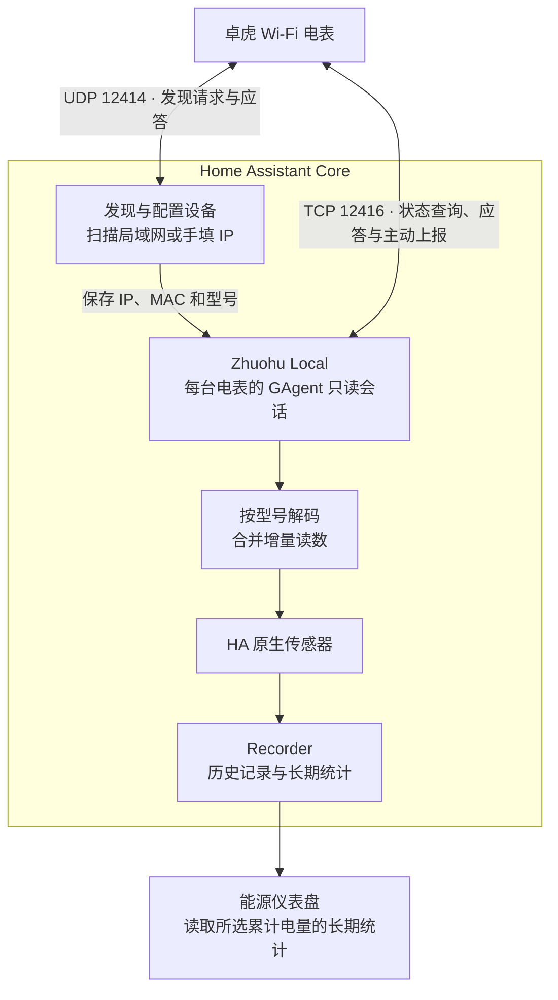

# 卓虎电表本地集成

在 Home Assistant 中直接读取卓虎 Wi-Fi 电表。集成通过局域网接收电表上报，为每台表创建独立设备和传感器。

| 支持型号 | 读数 |
| --- | --- |
| WiFi 单相电测模块 001 | 电压、电流、频率、功率因数、有功功率、无功功率、累计电量 |
| WiFi 三相电测模块 | 各相电压和电流，各相及合相的功率因数、有功功率、无功功率和累计电量 |

## 采集架构

发现阶段通过 `UDP 12414` 识别电表。添加后，HA 为每台电表主动建立独立的 `TCP 12416` 会话，每 3 秒发送心跳，每 30 秒查询状态，同时接收电表的主动上报。连接中断时，集成会重连。

每帧报文可能只包含部分数据点。集成按型号解码和换算，将本帧读数合并到各传感器的当前值。HA 通过 Recorder 保存历史记录，能源仪表盘按所选累计电量传感器读取长期统计。

## 安装

1. 从 GitHub 下载本仓库，把 `custom_components/zhuohu_local` 整个目录复制到 Home Assistant 的 `/config/custom_components/`。
2. 确认文件路径为 `/config/custom_components/zhuohu_local/manifest.json`，然后重启 Home Assistant Core。
3. 在「设置 → 设备与服务 → 添加集成」里搜索 **Zhuohu Local**。

## 添加电表

### 扫描局域网

选择「扫描局域网」，从结果中选一台电表。列表显示型号、IP 和 MAC 地址。其余电表可重复添加。

集成在 HA 已启用的私有 IPv4 网段发送 GAgent 发现报文。包含 512 个地址以内的网段还会逐地址查询。较大的网段使用广播发现。HA 与电表位于同一广播域时，扫描更容易成功。

### 手动填写 IP

选择「手动填写 IP」，输入电表的局域网 IPv4 地址。通常会自动识别型号和 MAC。UDP 发现无法识别时，页面会让你补充电表的 MAC 地址和型号，再验证 TCP 连接和实际读数。

建议在路由器上按 MAC 为各电表保留 IP。集成按 MAC 区分设备。

## 查看读数

在「设置 → 设备与服务 → Zhuohu Local」中选择电表，即可查看传感器。累计电量以 `kWh` 记录，可在 HA 的能源仪表盘中选择。三相电表提供各相和合相累计电量，统计总用电时选合相。

## 常见问题

- **扫描不到电表**。确认电表已连接 Wi-Fi，HA 与电表所在网络允许 `UDP 12414` 发现。跨网段时可以手动输入 IP。
- **无法添加或读数显示不可用**。确认 HA 能连接电表的 `TCP 12416`，并检查路由器上的 IP 及 Wi-Fi 状态。集成会在连接中断后重连，连续两分钟没有有效读数时会标为不可用。
- **能源仪表盘暂时没有图表**。先确认累计电量传感器已有数字读数。长期电量统计按小时汇总。 [Home Assistant 长期统计文档](https://www.home-assistant.io/docs/configuration/long-term-statistics/)
